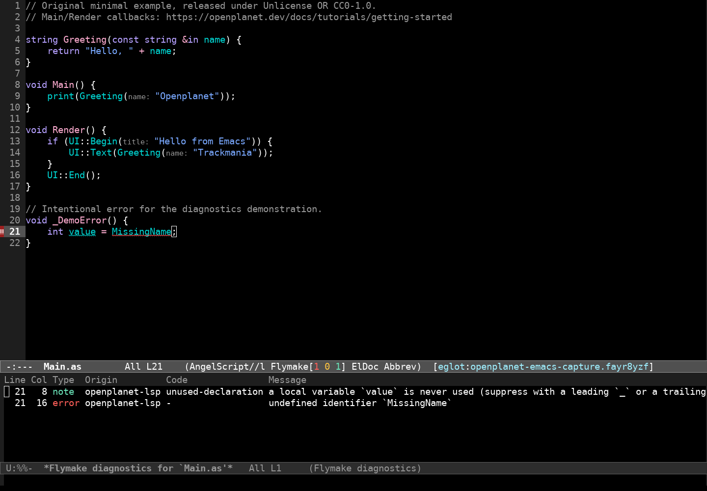

# Openplanet for Emacs

AngelScript editing and [openplanet-lsp](https://github.com/clankercode/lsp-openplanet)
integration for Emacs 29.1+. Use built-in Eglot or optional lsp-mode for completion,
diagnostics, hover, navigation, rename, and the server's other LSP features.



Actual GNU Emacs 31.1 on Xvfb, connected to openplanet-lsp 0.8.0. The example's
`MissingName` error is intentional. See [verification](docs/verification.md) for
the capture method, exact checks, and limits.

## Install

Install the language server separately using **one** of:

```sh
npm install -g openplanet-lsp
# or
cargo install openplanet-lsp
```

Alternatively extract the appropriate archive from
[server releases](https://github.com/clankercode/lsp-openplanet/releases).
Verify `openplanet-lsp --version` in a terminal. This package never downloads or
installs executable code at runtime.

Clone this repository, then add to your Emacs init:

```elisp
(add-to-list 'load-path "/absolute/path/to/lsp-openplanet-emacs")
(require 'openplanet)
(openplanet-setup)
```

Or install directly with built-in package-vc (Emacs 29.1+):

```elisp
(package-vc-install
 '(openplanet :url "https://github.com/clankercode/lsp-openplanet-emacs"
              :main-file "openplanet.el"))
```

Then use the same `require` and `openplanet-setup` forms. To install the downloaded
single file instead, `M-x package-install-file RET /path/to/openplanet.el RET`.
MELPA is **not available yet**; the recipe and eligibility steps are in
[publishing](docs/publishing.md).

## Eglot

Open a `.as` file and run `M-x openplanet-eglot`. For automatic startup:

```elisp
(add-hook 'openplanet-angelscript-mode-hook #'eglot-ensure)
```

`C-M-i` completes at point, `M-.` jumps to definitions, `M-,` returns,
`M-x eglot-rename` renames, and `M-x flymake-show-buffer-diagnostics` opens
diagnostics. Eglot provides hover information through Eldoc.

## lsp-mode

Install `lsp-mode` separately from MELPA. Use `M-x openplanet-lsp`, or:

```elisp
(require 'lsp-mode)
(openplanet-setup)
(add-hook 'openplanet-angelscript-mode-hook #'lsp-deferred)
```

Choose one client per buffer. `openplanet-setup` loads built-in Eglot and registers
clients but starts no server; it registers lsp-mode when that package is loaded.
The interactive `openplanet-lsp` command loads lsp-mode before registering it.

## Plugin manifests and roots

`.as` files automatically use `openplanet-angelscript-mode`, derived from
`c++-mode` for indentation, comments, and syntax highlighting. Semantic language
services come from the server. This is not a standalone full AngelScript parser.

Manifest support is opt-in:

```elisp
(openplanet-enable-manifests)
;; With Eglot:
(add-hook 'openplanet-info-mode-hook #'eglot-ensure)
;; OR with lsp-mode:
;; (add-hook 'openplanet-info-mode-hook #'lsp-deferred)
```

Only the basename `info.toml` selects `openplanet-info-mode`, which derives from
built-in `conf-toml-mode` and retains TOML editing. Other TOML files and their
language servers stay unchanged. Emacs's normal filename matching is
case-insensitive by default and recognizes backup suffixes. If another project
also uses `info.toml`, enable this association selectively in your trusted
configuration, or run `M-x openplanet-info-mode` manually. Disable future
associations with `M-x openplanet-disable-manifests`. Existing buffers keep their
mode until revisited or changed explicitly.

Eglot bundled with Emacs 29 uses separate server connections for source and
manifest buffers because it supports only one language ID per connection.
Current Eglot (including Emacs 30+) shares one server for both modes.

Project discovery uses the nearest `info.toml` or `.openplanet-lsp.toml` marker,
before Git's outer repository root. For an isolated source file, its directory
is the root. Put `.openplanet-lsp.toml` in a workspace parent when appropriate;
the server also reads parent configuration for per-plugin projects.

## Configuration and executable safety

```elisp
;; One executable, with no embedded arguments. Spaces in paths are supported.
(setq openplanet-server-executable "/absolute/path/to/openplanet-lsp")
```

The default resolves `openplanet-lsp` through Emacs's `exec-path`. Every launch
passes a separate `--lsp` argument for stdio. An invalid explicit path errors
instead of falling back. Shell syntax, environment expansion, relative paths
containing directories, and remote/TRAMP buffers are unsupported. This is a
risky local variable: configure it in trusted init code, not `.dir-locals.el`.

No default initialization options override the server. Configure
`.openplanet-lsp.toml` in your plugin/workspace using the server's documented
snake_case keys. Configuration precedence is initialization options, plugin
config, parent workspace config, user `~/.config/openplanet-lsp/config.toml`,
then auto-detection. The server discovers your actual Openplanet type databases;
no example type database is installed by this package. See the
[server documentation](https://github.com/clankercode/lsp-openplanet).

## Troubleshooting

- **Executable unavailable:** check `(executable-find "openplanet-lsp")`. GUI
  Emacs may inherit a different PATH from your terminal; set the absolute option.
- **No diagnostics:** run `M-x openplanet-eglot`, then check `M-x eglot-events-buffer`
  and `M-x flymake-show-buffer-diagnostics`. With lsp-mode use `M-x lsp-describe-session`.
  If Emacs 30 reports “untrusted content,” review the project and add only its
  directory to `trusted-content` using Customize; the package does not grant trust.
- **Wrong root:** ensure `openplanet-setup` ran and evaluate
  `(project-root (project-current))` with `M-:` to inspect the plugin root.
  Reconnect Eglot after changing the project layout.
- **Manifest opens as ordinary TOML:** enable manifest support before visiting it,
  then revert/revisit the buffer or select `openplanet-info-mode`.
- **Types/completions missing:** check server type DB detection and game target.
  The included example does not supply substitute game definitions.

## Development

```sh
make check                  # byte compile with warnings fatal; focused ERT
make integration            # real Eglot + installed server; fails if unavailable
make lsp-test               # requires installed lsp-mode
bash scripts/screenshot.sh  # real GUI; needs Xvfb, ImageMagick, GUI Emacs
```

`EMACS=/path/to/emacs` selects another Emacs. `OPENPLANET_PACKAGE_DIR` selects
an isolated lsp-mode package directory for `make lsp-test`.
[Verification](docs/verification.md) distinguishes tested behavior from limits.

## License

Choose **Unlicense OR CC0-1.0**. Full texts: [UNLICENSE](UNLICENSE) and
[LICENSE-CC0](LICENSE-CC0). The example is original code following the
[Openplanet callback tutorial](https://openplanet.dev/docs/tutorials/getting-started),
under the same license. Third-party Emacs, Eglot, and lsp-mode keep their licenses
and are not vendored here.
